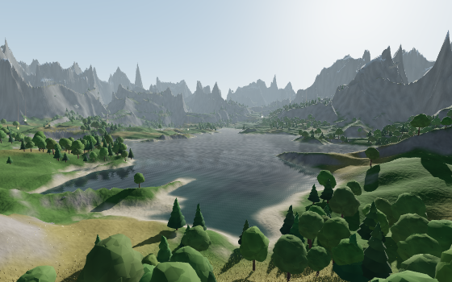

# Ember Valley

A first-person 3D browser game built to push the **AMD Ryzen AI Max+ 395** (Strix Halo) — 16 Zen 5 cores, Radeon 8060S graphics and a large pool of shared memory.

Twelve embers are scattered across a mountain valley at golden hour. Gather all of them before the sun sets and the valley goes dark.

## Play

Open `index.html` in Chrome or Edge. An internet connection is needed the first time so it can load three.js and the fonts from a CDN.

| Key | Action |
| --- | --- |
| W A S D / arrows | Walk |
| Shift | Run |
| Space | Jump |
| Mouse | Look (click the view to capture the mouse) |
| F | Performance panel |
| M | Sound on/off |
| Esc | Pause |

On a touchscreen, drag the left side to move and the right side to look.

## How it uses the 395

- **Every CPU thread:** each valley is carved in parallel with one Web Worker per thread (up to 32), each working on its own band of terrain rows. The start screen shows a live bar for every thread.
- **Radeon 8060S:** the Strix Ultra preset draws 820,000 GPU-instanced grass blades that read terrain height straight from a texture on the GPU, sway in the wind and glow when backlit. It also renders a 1025 × 1025 terrain (over a million points), thousands of instanced trees and rocks, 4K soft shadows and real-time planar reflections on the lake.
- **Shared memory:** the whole full-detail world stays loaded at once, so there is no streaming or pop-in.
- **Living sky:** a physical sky model drives the lighting, fog and image-based lighting as the sun goes from afternoon to sunset to a starry night.

## Quality presets

| Preset | Terrain | Grass blades | Shadows | Water |
| --- | --- | --- | --- | --- |
| Low | 257² | 90k | 1K | Sky tint |
| High | 513² | 320k | 2K | Reflections |
| Strix Ultra | 1025² | 820k | 4K | Sharp reflections |

The game suggests a preset based on your thread count and GPU.

## Notes

This is a browser game, so it runs on the CPU and GPU through WebGL. It doesn't use the NPU, which browsers can't reach.
